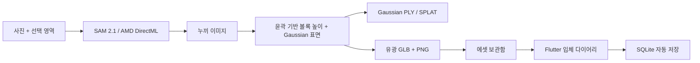

# GoodMorNing ☀️

사진 속 굿즈를 모으고, 볼록 스티커로 만들어 다이어리를 꾸미는 **Flutter Web + 로컬 GPU 서버** 앱입니다.

원본 [프로토타입](https://github.com/mokma18/goodmorning-prototype-demo)의 하늘색 UI와 홈·에셋·다이어리 구성을 Flutter로 옮겼습니다. 입체 다이어리는 Flutter의 웹 뷰 안에서 Three.js로 렌더링합니다. 스티커의 테두리·볼록 메시·유광 GLB 생성 함수는 [goodmorning-3d](https://github.com/bloodmoon3929/goodmorning-3d)의 `pipeline/sticker.py`에서 재사용합니다.

## 구현된 기능

- 사진 업로드 후 사각형으로 굿즈 영역 선택
- **SAM 2.1**로 누끼 분리: Windows의 ONNX Runtime DirectML로 로컬 AMD GPU 사용
- 누끼 이미지로 가우시안 입자와 볼록한 표면을 만들고 `.ply`, `.splat`, `.glb`, PNG 저장
- 생성 작업의 대기·진행률·실패 표시, 완료된 스티커를 에셋 보관함에 추가
- 다이어리에 스티커와 폴라로이드 추가, 끌어서 이동, 크기·회전·순서 조절, 선택 항목 제거
- 다이어리 제목·메모·종이 색 편집, 입체 기울이기, PNG 내보내기
- SQLite에 에셋·생성 작업·다이어리 저장. 새로고침 후 다시 불러오기
- 같은 PC에서 앱과 API를 함께 제공. 접근 키로 보호된 임시 외부 접속 링크

## 스티커 처리 흐름



**SAM 3D는 새 스티커 생성에 사용하지 않습니다.** 현재 사진 한 장의 보이는 면과 윤곽에서 높이를 만드는 **2.5D Gaussian relief** 구현입니다. 여러 시점의 사진으로 최적화하는 3D Gaussian Splatting 학습이나 보이지 않는 뒷면의 3D 복원은 포함하지 않습니다. 가우시안 표현은 PLY/SPLAT로 저장하며, 다이어리에서는 같은 표면을 GLB 메시로 베이크해 유광 반사를 표시합니다. 원본 저장소에서 가져온 기본 스티커 3개는 미리 생성된 샘플이며 출처는 메타데이터에 구분됩니다.

배경을 지우려면 사진에서 **굿즈를 감싸는 사각형을 직접 그려 주세요.** 전체 사진에 손이나 여러 물체가 함께 있으면 선택 영역에 따라 누끼 결과가 달라집니다. 이미 투명한 PNG는 알파를 사용합니다. ‘배경 포함’ 선택 시 사진 전체를 스티커로 만듭니다.

## 파일 구조

```text
GoodMorNing/
├─ app/                         Flutter Web 앱
│  ├─ lib/
│  │  ├─ main.dart             홈·에셋함·다이어리·사진 선택 화면
│  │  ├─ api.dart              API 요청과 업로드
│  │  └─ diary_scene.dart      Flutter ↔ Three.js 메시지 연결
│  ├─ assets/wordmark.png      원본 프로토타입 워드마크
│  ├─ web/                    웹 진입점·아이콘·manifest
│  ├─ test/                   API 응답 처리 테스트
│  └─ pubspec.yaml
├─ server/
│  ├─ app.py                  FastAPI, 작업 큐, SQLite, 파일 제공
│  ├─ gpu.py                  GPU 선택·SAM 2 encoder/decoder 추론
│  ├─ stickers.py             누끼 → 볼록 스티커 생성
│  ├─ gaussian.py             Gaussian 표면·PLY/SPLAT 내보내기
│  ├─ access.py               외부 접속 키·세션 쿠키
│  ├─ vendor/sticker_geometry.py  원본 스티커 함수 재사용
│  ├─ scene/                  Three.js 입체 다이어리와 로컬 라이브러리
│  ├─ test_app.py             생성·저장·입력·접근 제어 테스트
│  └─ requirements-windows-lock.txt
├─ scripts/
│  ├─ setup.ps1               새 PC에서 환경 구성
│  ├─ setup_models.py         고정 버전 SAM 2 ONNX 모델 다운로드
│  ├─ build.ps1               Flutter 웹 빌드
│  ├─ start.ps1               앱/API 백그라운드 실행
│  ├─ tunnel.ps1              외부 접속 링크 생성
│  ├─ stop.ps1                이 프로젝트의 서버·터널 종료
│  ├─ browser_check.py        수동 실행 가능한 브라우저 확인 도구
│  └─ smoke_generate.py       샘플 생성 확인 도구
├─ prototype/                 프로토타입 Git submodule
├─ sticker-engine/            goodmorning-3d Git submodule
├─ data/                      로컬 전용, Git 제외
│  ├─ goodmorning.sqlite3      에셋·작업·다이어리 DB
│  ├─ assets/<id>/             원본 사진, 스티커, 메타데이터
│  ├─ models/sam2/             SAM 2 ONNX 모델 약 155MB
│  ├─ access.key              외부 접속 키
│  └─ verification/           로컬 검증 기록
├─ tools/                     로컬 Flutter SDK·cloudflared, Git 제외
├─ .venv/                     프로젝트 Python 환경, Git 제외
├─ logs/                      서버 로그·PID·접속 링크, Git 제외
├─ THIRD_PARTY.md              재사용 코드·모델 출처
└─ README.md
```

## 현재 PC에서 실행

프로젝트 위치: `C:\Users\meer\Downloads\goodmorning`

```powershell
cd C:\Users\meer\Downloads\goodmorning
.\scripts\start.ps1
```

PC 안에서: **http://127.0.0.1:8787**

코드를 수정했다면 Flutter 앱을 다시 빌드합니다. 서버 Python 코드 수정 후에는 서버를 재시작합니다.

```powershell
.\scripts\build.ps1
.\scripts\stop.ps1
.\scripts\start.ps1
```

현재 구성은 Windows / Python 3.12 / Flutter stable / AMD Radeon RX 9070 XT입니다. 시스템 전역 Flutter PATH는 변경하지 않았습니다.

## 새 PC에서 설치

Git과 Python 3.12가 필요합니다. Windows DirectX 12 GPU에서는 DirectML을 사용하며, DirectML이 없는 환경에서는 CPU provider를 사용할 수 있습니다. 기본 설치 스크립트와 lock 파일은 Windows용입니다.

```powershell
git clone --recurse-submodules https://github.com/niraaah/GoodMorNing.git
cd GoodMorNing
.\scripts\setup.ps1
.\scripts\start.ps1
```

원본 저장소는 submodule로 고정되어 있습니다. 모델·SDK·사용자 사진·DB는 GitHub에 올리지 않으며, setup 과정에서 필요한 SDK와 모델을 받습니다. 모델 버전과 다운로드 파일의 해시는 `data/models/sam2/manifest.json`에 기록됩니다.

## 휴대폰·외부에서 접속

```powershell
.\scripts\tunnel.ps1
```

출력된 **`https://…trycloudflare.com/connect#…` 전체 링크**로 접속합니다. 접근 키는 URL fragment에서 읽은 뒤 주소창에서 제거하고 HttpOnly 세션 쿠키로 전환합니다. 같은 링크는 `logs/access-link.txt`에도 저장됩니다. 키 없는 외부 요청은 사진·API에 접근할 수 없습니다.

- 이 PC와 서버·터널 프로세스가 켜져 있어야 합니다.
- 임시 터널을 새로 시작하면 주소가 바뀝니다. 운영용 고정 도메인은 별도 설정이 필요합니다.
- 사진 처리는 이 PC에서 실행됩니다. 외부 접속의 HTTPS 트래픽은 Cloudflare Tunnel을 경유합니다.
- 현재는 한 사용자의 공용 에셋함입니다. 링크를 공유받은 사람도 같은 데이터에 접근하므로 전체 접속 링크를 공개 저장소에 올리지 마세요.

```powershell
.\scripts\stop.ps1 -TunnelOnly  # 외부 접속만 종료
.\scripts\stop.ps1              # 서버와 터널 종료
```

## 주요 API

| 경로 | 역할 |
| --- | --- |
| `GET /api/health` | 서버·SAM 2 모델·GPU provider 상태 |
| `GET /api/assets` | 에셋 목록 |
| `POST /api/stickers` | multipart `photo`, `name`, `box` → 비동기 스티커 생성 |
| `GET /api/jobs/{id}` | 생성 상태와 진행률 |
| `POST /api/photos` | 폴라로이드 사진 저장 |
| `GET /api/diaries` | 저장된 다이어리 |
| `PUT /api/diaries/{id}` | 다이어리와 배치 저장 |
| `GET /files/{id}/sticker.glb` | 입체 스티커 |
| `GET /files/{id}/sticker.ply` | Gaussian PLY |

`box`는 `[left, top, right, bottom]` JSON 문자열이며 각 좌표는 0~1입니다. 사진 크기는 최대 16MB, 2,400만 화소이고 처리용으로 축소됩니다. 생성은 GPU 작업 한 개씩 순차 처리합니다.

## 확인된 범위와 남은 확인

- SAM 2.1이 RX 9070 XT의 DirectML provider에서 실제 실행됨을 프로파일로 확인했습니다. 일부 연산은 CPU provider가 처리합니다.
- 저장소 샘플의 선택 영역으로 GPU/CPU 결과를 비교했으며, 제공된 참조 마스크와의 IoU는 약 0.971입니다. 전체 사진을 선택하는 경우 같은 품질을 보장하지 않습니다.
- 서버 자동 테스트 4개와 Dart 응답 처리 테스트 2개가 통과했고 Flutter release 웹 빌드가 완료되었습니다.
- Flutter 분석에는 스타일 관련 info가 남아 있습니다. 웹 브라우저에서의 최종 조작·시각 검증은 사용자가 직접 진행할 예정이며 완료로 표시하지 않습니다.
- 사용자 요청에 따라 추가 자동 테스트는 중단했습니다. 제공한 확인 스크립트는 필요할 때 직접 실행할 수 있습니다.
- 샘플 생성 확인 스크립트는 실제 에셋과 다이어리 데이터를 추가합니다.

```powershell
.\.venv\Scripts\python.exe -m pytest server\test_app.py -q
cd app
..\tools\flutter\bin\flutter.bat test
```
